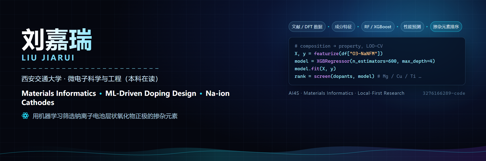

  

  

  
  
  

## Hi, 我是 刘嘉瑞 (Liu Jiarui)

西安交通大学**微电子科学与工程**本科在读。关注 **AI4S (AI for Science)** 与 **Materials Informatics (材料信息学)**：把机器学习、集成学习与大语言模型接到真实的材料问题上 —— 用成分特征预测性能、用模型给掺杂元素排序，而不是靠试错。

- 🎓 **单位**：西安交通大学 · 微电子科学与工程（本科在读）
- 🔬 **研究方向**：材料信息学、机器学习驱动的掺杂设计、钠离子电池正极、LLM Agent
- 🛠️ **主要工具**：Python、scikit-learn、XGBoost、pandas、NumPy、PyTorch、LaTeX、Electron
- 💻 **在做的系统**：[览籍智研](https://github.com/3276166289-code/research-workbench) —— 本地优先、证据优先的科研工作台

## Tech Stack

  

  
  
  
  
  
  
  
  

## 🧪 Research in Progress

> 起步阶段，先把手上的工作做扎实：还没有正式发表，下面是正在推进的两条线。

1. **O3 型 Na(Ni-Fe-Mn)O₂ 正极的金属掺杂筛选** 🔬 *(Main)*
   以成分特征（元素电负性／离子半径／价态等 Magpie 式描述符）为输入，用随机森林与 XGBoost 回归预测结构稳定性与电化学性能，再据此给出掺杂元素的**连续权重排序**，而不是硬切阈值筛选。
   *方法学关注点：换元外推的可信边界，训练集与验证集的切分口径必须对齐才谈得上互相比较。*

2. **文献 → 结构化数据的抽取流水线**
   把材料文献里的「成分 — 工艺 — 性能」三元组批量抽成结构化表格，作为建模的数据底料；抽取结果逐条回查原文，保证数字可溯源。

## Featured Projects

<table>
  <tr>
    <td width="50%">
      <h3 align="center">览籍智研 · Research Workbench</h3>
      
本地优先的科研工作台：选题 → 检索 → 精读 → 梳理 → 写作 → 投稿一条链，AI 只出草稿，每一步都留证据、都能人工复核。数据全在自己机器上。

      

        
      

    </td>
    <td width="50%">
      <h3 align="center">机器学习掺杂预测</h3>
      
钠离子电池层状氧化物正极的掺杂元素排序：成分特征工程 + 集成学习 + 换元外推验证。代码与数据整理中，暂未公开。

      

        
        
      

    </td>
  </tr>
</table>

## GitHub Analytics

  
  
  

## Contribution Graph

  <picture>
    <source media="(prefers-color-scheme: dark)" srcset="https://raw.githubusercontent.com/3276166289-code/3276166289-code/output/github-contribution-grid-snake-dark.svg" />
    <source media="(prefers-color-scheme: light)" srcset="https://raw.githubusercontent.com/3276166289-code/3276166289-code/output/github-contribution-grid-snake.svg" />
    
  </picture>

  

---

  <strong>用机器学习少走一点试错，让每个数字都能回到原文。</strong>
   
  <a href="mailto:2441060158@qq.com">Email</a>
  ·
  <a href="https://github.com/3276166289-code">GitHub</a>
  ·
  <a href="https://github.com/3276166289-code/research-workbench">览籍智研</a>

